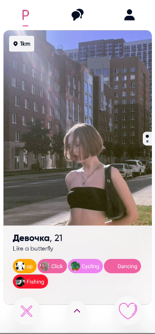
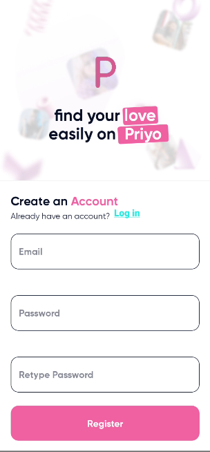
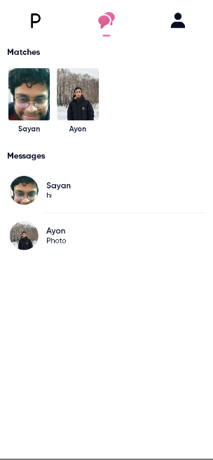
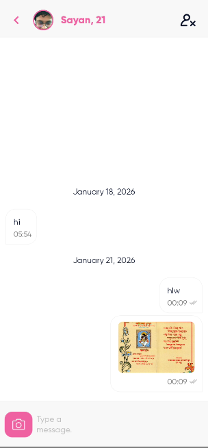
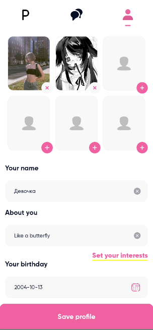
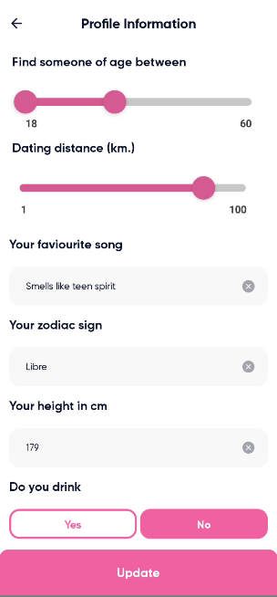
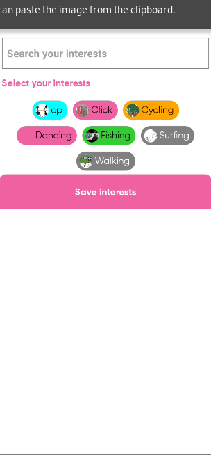

# Priyo - Dating App

## Overview

Priyo is a mobile dating application built using React Native and Expo. It offers a comprehensive suite of features to help users connect with potential matches.

## Key Features

- **Swiping:** Users can swipe through profiles to indicate interest or pass.
- **Location:** Users can share their location to find nearby matches.
- **Security:** Robust security measures to protect user data and privacy.
- **Real-time Direct Messaging:** Instant messaging for seamless communication with matches.
- **Profile Pictures:** Users can upload and manage their profile pictures.
- **User Profiles:** Detailed user profiles with customizable information.
- **Matching Algorithm:** Algorithm to suggest potential matches based on user preferences.
- **Push Notifications:** Real-time notifications for new matches, messages, and other activities.

## Technologies Used

- **React Native:** A JavaScript framework for building native mobile apps.
- **Expo:** A platform for building universal React applications.
- **Backend:** Backend services for authentication, database, and real-time messaging. (https://gitlab.com/FakeCoder01/Priyo)

## Getting Started

### Prerequisites

- Node.js and npm installed
- Expo CLI installed (`npm install -g expo-cli`)
- A smartphone or emulator with the Expo Go app installed

### Installation

1.  Clone the repository:

    ```bash
    git clone https://github.com/FakeCoder01/Priyo.git
    cd Priyo
    ```

2.  Install dependencies:

    ```bash
    yarn
    ```

### Usage

1.  Start the Expo development server:

    ```bash
    npx expo start
    ```

2.  Scan the QR code with the Expo Go app on your phone, or run on an emulator.

## Project Structure

The project structure is organized as follows:

- `/src`: Contains the main source code of the application.
  - `/@types`: Contains TypeScript type definitions.
  - `/assets`: Contains static assets such as images and fonts.
  - `/components`: Contains reusable React components.
  - `/services`: Contains services for API calls and data handling.
  - `/store`: Contains the Redux store configuration.
  - `/views`: Contains the main screens/views of the application.
  - `constants.ts`: Defines application-wide constants.
  - `index.tsx`: The main entry point of the application.
  - `themes.ts`: Defines the application's themes and styling.

## Dependencies

- "@react-native-async-storage/async-storage": "1.18.2"
- "@react-native-community/datetimepicker": "7.2.0"
- "@react-native-community/netinfo": "9.3.10"
- "@react-native/assets-registry": "^0.75.0-main"
- "@react-navigation/elements": "^1.3.3"
- "@react-navigation/material-top-tabs": "^6.2.1"
- "@react-navigation/native": "^6.0.10"
- "@react-navigation/stack": "^6.2.1"
- "@reduxjs/toolkit": "1.8.2"
- "@svgr/webpack": "^8.1.0"
- "@use-expo/font": "^2.0.0"
- "axios": "^1.6.8"
- "babel-plugin-module-resolver": "^5.0.0"
- "color": "^4.2.3"
- "eas-cli": "^7.8.2"
- "expo": "49"
- "expo-asset": "~8.10.1"
- "expo-blur": "~12.4.1"
- "expo-font": "~11.4.0"
- "expo-image-picker": "~14.3.2"
- "expo-linear-gradient": "~12.3.0"
- "expo-location": "~16.1.0"
- "expo-permissions": "~14.2.1"
- "expo-splash-screen": "~0.20.5"
- "expo-status-bar": "~1.6.0"
- "expo-updates": "~0.18.19"
- "graphql": "^16.5.0"
- "immer": "^10.1.1"
- "lodash": "^4.17.21"
- "lottie-react-native": "5.1.6"
- "metro-react-native-babel-transformer": "^0.77.0"
- "moment": "^2.29.1"
- "package.json": "^2.0.1"
- "react": "18.2.0"
- "react-content-loader": "^7.0.0"
- "react-dom": "18.2.0"
- "react-native": "0.72.10"
- "react-native-draggable-grid": "^2.1.3"
- "react-native-error-boundary": "^1.1.9"
- "react-native-geolocation-service": "^5.3.1"
- "react-native-image-picker": "^7.0.1"
- "react-native-masked-text": "^1.13.0"
- "react-native-pager-view": "6.2.0"
- "react-native-range-slider-expo": "^1.4.3"
- "react-native-reanimated": "~3.3.0"
- "react-native-restart": "^0.0.27"
- "react-native-safe-area-context": "4.6.3"
- "react-native-screens": "~3.22.0"
- "react-native-svg": "13.9.0"
- "react-native-svg-transformer": "^1.0.0"
- "react-native-tab-view": "^3.1.1"
- "react-native-uuid": "^2.0.1"
- "react-native-web": "~0.19.6"
- "react-redux": "^9.1.1"
- "reactotron-react-native": "^5.0.0"
- "reactotron-redux": "^3.1.3"
- "reactotron-redux-saga": "^4.2.3"
- "reduce-reducers": "^1.0.4"
- "redux": "4.1.0"
- "redux-persist": "^6.0.0"
- "redux-saga": "^1.1.3"
- "reselect": "^5.1.0"
- "styled-components": "^6.1.8"
- "typesafe-actions": "^5.1.0"

## Demo

#### Video

[](ref/vid.mp4)

#### Images

[](ref/login.png)
[](ref/signup.png)
[](ref/swipe.png)
[](ref/profile.gif)
[](ref/match.png)
[](ref/chat.png)
[](ref/settings.png)
[](ref/account.png)
[](ref/reset.png)
[](ref/tag.png)
